# Hubs for Free


Run the standard head-interaction pipeline on random matrices and it finds
a coordinator head, a spectral gap, and a symbolic law. Run it on a trained
language model and it finds the same things, for a different reason: the
attention heads of a layer are, to first order, one shared operator, and
that operator is the attention sink. This repository follows that thread
from a null result to a one-parameter law that holds from 0.1B to 8B
parameters across ten architecture families, three position schemes and
three attention layouts, and along the training of two models, and turns
the instruments built along the way into a toolkit that anyone analyzing
attention can run.

## How the findings connect

**Random matrices already contain the signatures.** On causal softmax
matrices with no training behind them, the pipeline that looks for
structure among heads finds it every time: a dominant hub, a large
eigengap, a one-versus-(n-1) spectrum, and a "special" head flagged by the
2-sigma rule in 62 percent of draws at 14 heads and 96 percent at 32. A
formula search on structure constants extracted from noise reaches the
same fit quality as the archived real-model search. Two four-line proofs
explain why: row-stochasticity forces one shared invariant direction on
every attention layer, and for causal attention the generator norm obeys
2||G||_F^2 = sum_i (IPR_i - A_ii^2) exactly, so it measures sharp non-self
attention and nothing else. The whole battery regenerates in under a
minute on a laptop.

<p align="center">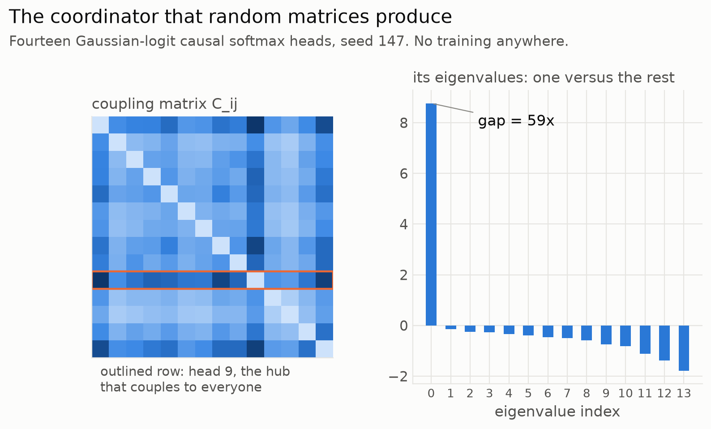</p>

<p align="center"><em>Fourteen random heads, no training: a hub that couples to everyone and a 59-fold spectral gap.</em></p>

<p align="center">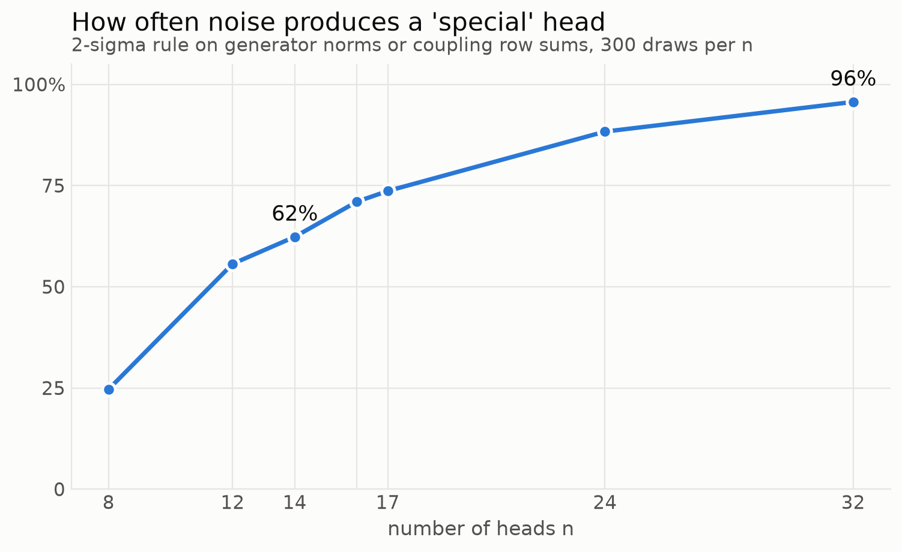</p>

<p align="center"><em>The 2-sigma rule finds a special head in noise most of the time, and almost always past 24 heads.</em></p>

**Trained models depart from the random picture, in one specific way.**
On noise, the pairwise coupling matrix of a layer's heads is almost
exactly rank one in the head norms (correlation 0.98 with the norm-product
matrix). On a trained model it is not: at the deepest sink layers the
correlation falls to -0.5 and below. Surrogates that keep every head's
per-row sharpness and self-mass but scramble the rest restore the random
picture perfectly, so the departure is real inter-head structure, and the
question became what it is.

<p align="center">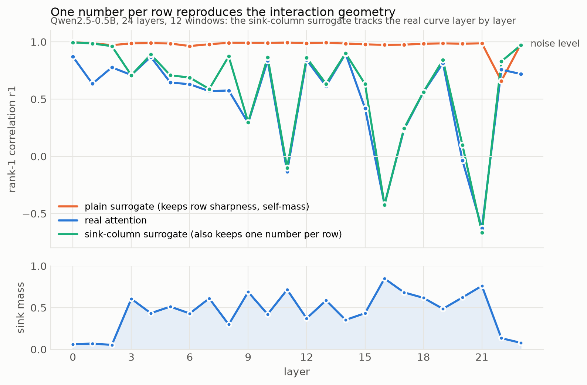</p>

<p align="center"><em>Marginal-matched surrogates stay at the noise level; the sink-column surrogate follows the real curve layer by layer.</em></p>

**It is one shared operator, and the operator is the sink.** Stack the
skew-symmetric parts of a layer's heads and take their top principal
component. Across 230 high-sink layers of eleven models (Qwen2.5 0.5B to
7B in base and Instruct form, GPT-2 medium, Pythia-410m, TinyLlama-1.1B,
Mistral-7B, Phi-3-mini, OLMo-2-7B) that component is the ideal sink
operator at every one of them, with cosine 0.71 to 1.00 and above 0.87 at
91 percent of layers. It carries 0.51 to 0.99 of each head's energy. It
spans grouped-query KV groups, so the architecture does not create it, and
instruction tuning leaves it untouched. A later rerun of all thirteen
models under one protocol, with 48 windows per model and the instruments
fixed, reproduces this at every high-sink layer of every model.

<p align="center">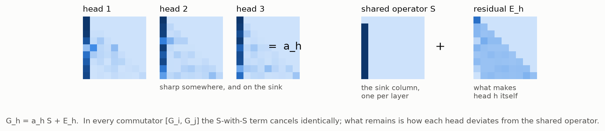</p>

<p align="center"><em>Every head is a multiple of the same operator plus a residual of its own.</em></p>

<p align="center">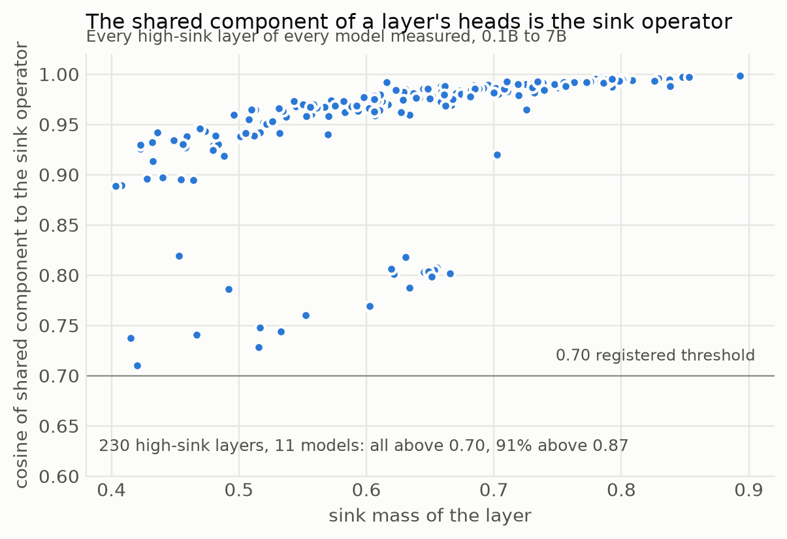</p>

<p align="center"><em>230 high-sink layers across eleven models: the shared component is the sink operator in every one.</em></p>

<p align="center">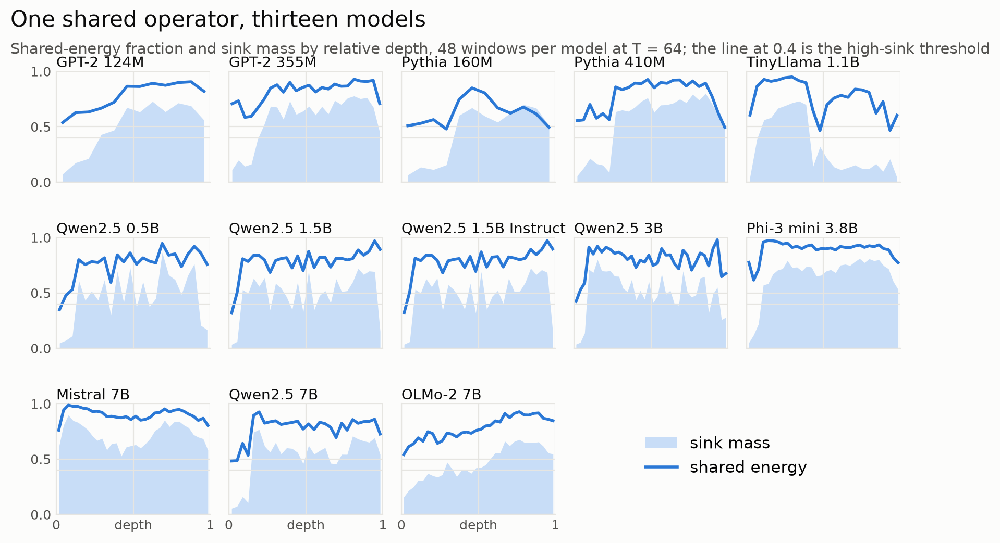</p>

<p align="center"><em>Seventeen models, one shape: the shared-energy fraction rises with the sink mass and stays high wherever the sink does. The last four add learned positions, ALiBi, multi-query attention and a new generation.</em></p>

**The shared operator cancels out of every interaction statistic.**
Writing each head as G_h = a_h S + E_h, the shared-times-shared term
vanishes identically in every commutator,
[G_i, G_j] = a_i [S, E_j] - a_j [S, E_i] + [E_i, E_j],
and on real models the cross terms outweigh the deviation term by 4x to
25x at every head pair tested. This is why interaction statistics on
trained attention behave as they do: a surrogate that preserves each
row's sharpness, self-mass, and one number per row, the sink-column
entry, reproduces the real coupling statistics layer by layer, to three
decimals at the deepest layers of Mistral-7B. At this resolution the
statistics contain nothing else. A preregistered generative test makes
the point directly: rebuilding each head from its real sink column alone,
with random entries everywhere else, reproduces the per-layer coupling
statistics of eleven of twelve models (Spearman 0.85 to 0.99 with the real
z profile, pooled 0.95 over 310 layers, against 0.13 when the sink column
is replaced by a shared average). A layer's heads are their sink-column
profiles plus noise; the one exception, TinyLlama's late layers, has no
sink to be a profile of. A further preregistered round asked whether any
of this depends on the attention design shared by the first thirteen
models, which all use rotary or learned positions with multi-head or
grouped-query attention. On Falcon-7B (multi-query attention, one key and
value head for 71 query heads), BLOOM-7b1 (ALiBi position bias), OPT-6.7B
(learned absolute positions) and Qwen3-8B, every clause held: the shared
operator is the sink at 100 percent of high-sink layers in all four, the
dissociation holds at 100 percent, the law reaches Spearman -0.84, and the
sink-profile rebuild reproduces the coupling statistics at Spearman 0.90 to
0.98 per model and 0.97 pooled. The statement is about softmax attention
with a sink token, not about one family's design. Where the sink wanders between columns
from one input to the next (OLMo-2), a set of at most three columns does
the same job: the model that failed the one-column test at 19 percent of
layers passes the column-set test at 79.

<p align="center">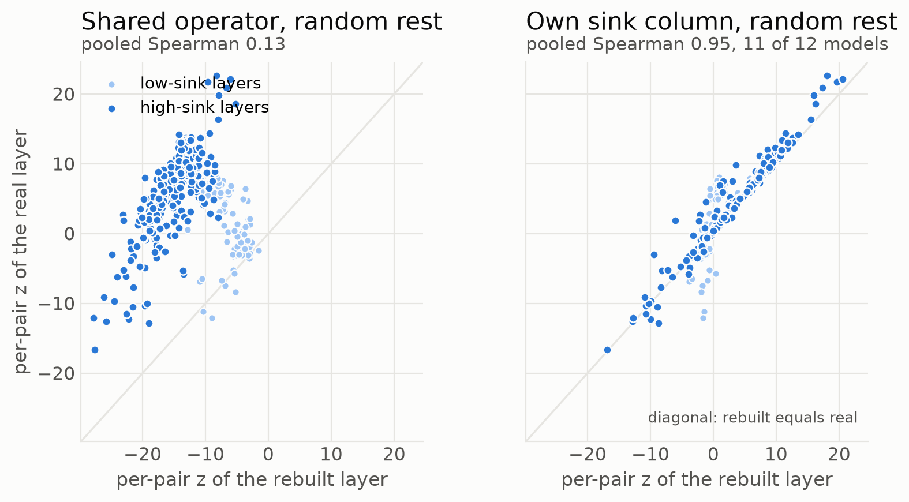</p>

<p align="center"><em>Sixteen models, 440 layers: rebuild the heads from a shared operator and the coupling statistic is lost; rebuild each from its own sink column and it is recovered, on multi-query, ALiBi and learned-position designs as well.</em></p>

<p align="center">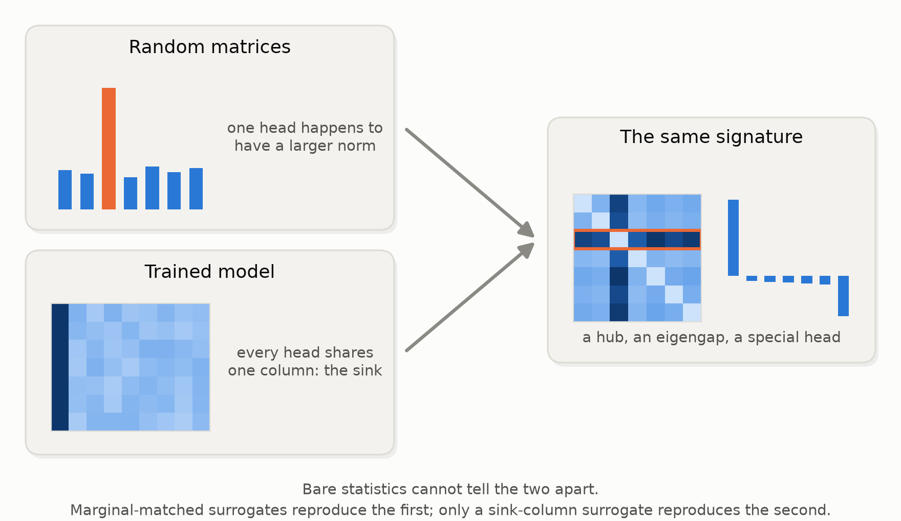</p>

<p align="center"><em>The same signature from two mechanisms; only constrained surrogates tell them apart.</em></p>

**Alignment does it, not concentration.** Heads that are each sharply
concentrated but on different columns show the opposite signature in
synthetic ensembles and in redesigned controls on five held-out models:
the shared mode collapses, the rank-one geometry returns, and commutators
grow rather than shrink. What the heads share is a column, not a habit of
sharpness. The first control lost its power at 32 heads, and a toy sweep
found the reason: in 64-token windows half of the rows cannot host 32
distinct target columns, so no permutation can misalign such a layer. At
256 tokens, with a control that treats every row alike, the dissociation
holds at every high-sink layer of every one of eleven models. In
Mistral-7B the shared mode falls to a tenth and the median per-pair z
rises from 78 to 271 across all 32 layers.

<p align="center">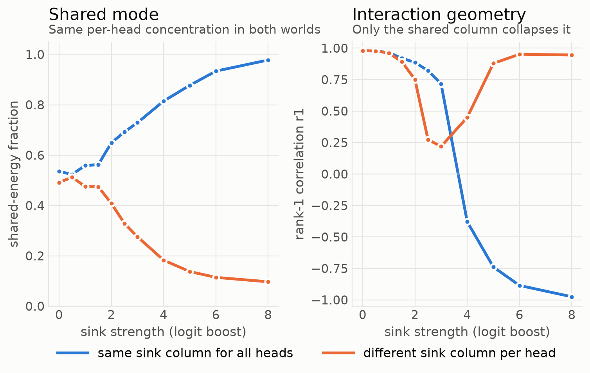</p>

<p align="center"><em>Same per-head concentration, opposite outcomes: only the shared column builds the shared mode and collapses the geometry.</em></p>

<p align="center">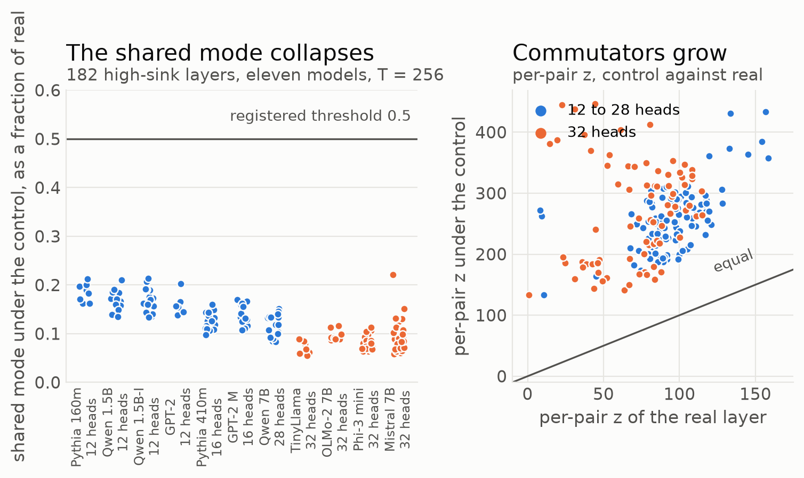</p>

<p align="center"><em>The fixed control on 182 high-sink layers of eleven models at 256 tokens: the shared mode collapses below half everywhere, and commutators grow at every layer, 32-head models included.</em></p>

**One number per layer predicts the geometry, and the prediction
transfers.** The layer's shared-energy fraction predicts its coupling
statistic at Spearman -0.76 across the high-sink layers of five held-out
models at or below 1.5B, and again at -0.76 in a separately preregistered
3B-to-7B round of 130 layers, and at -0.70 (model-clustered interval -0.78 to -0.57)
over 182 layers when all thirteen models were rerun under one protocol
with the ill-conditioned layers excluded. A fully synthetic toy ensemble,
built from nothing but noise plus one shared column, places the regime
flip between shared energy 0.85 and 0.93, exactly where the real layers
flip. Three numbers per head reproduce the development model's depth
profile at Spearman 0.81.

<p align="center">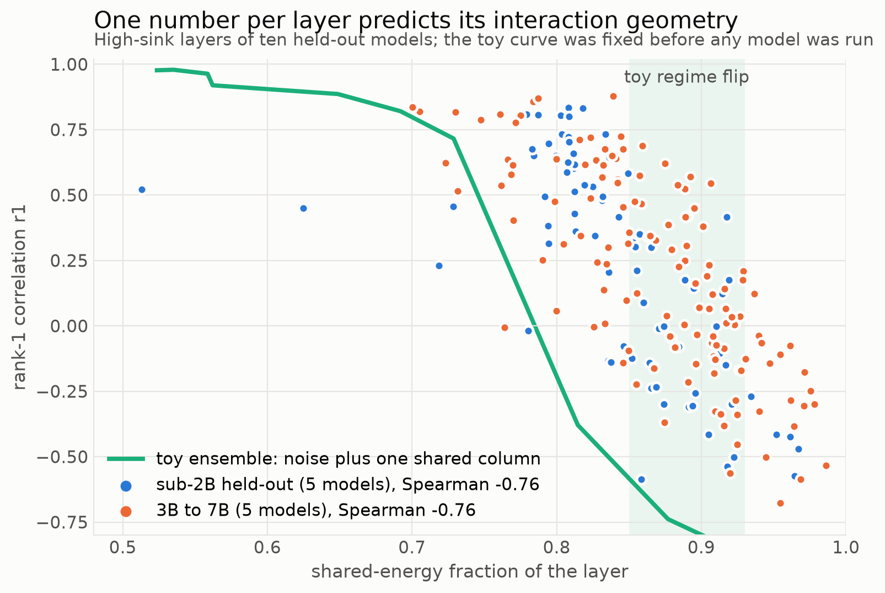</p>

<p align="center"><em>Ten held-out models across two preregistered rounds fall along the curve a noise-plus-one-column toy predicted in advance.</em></p>

**Training replaces one shared operator with another.** An untrained
network already has a dominant shared component: with near-uniform
attention every head carries the same operator, the uniform causal
operator (cosine 1.00 to it in every layer), at 0.9 of its energy, and
that component is not the sink (cosine 0.27). Ten public
checkpoints each of Pythia-160m and Pythia-410m, with every prediction
frozen and pushed before the first download, show what training does with
it. The initial component is broken up first, and by step 1000 the layers
sit in the random-matrix regime with no sink anywhere. Then the sink forms
abruptly, between steps 1000 and 2000 in the 410m and between 4000 and
8000 in the 160m, and in the same checkpoint the shared component becomes
the sink operator, cosine above 0.9, in 25 of the 26 layers that end
high-sink. From there alignment deepens and the layers ride down the same
curve as the converged models (Spearman -0.74 across 152 checkpoint-layer
cells), changing sign at shared energy 0.77 to 0.87, where the toy put
the crossing. One registered secondary prediction failed: the 160m forms
its sink later than step 4000.

<p align="center">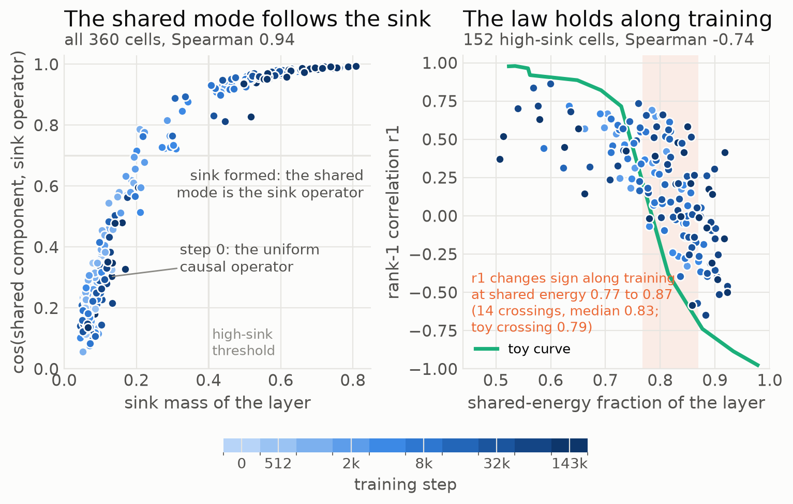</p>

<p align="center"><em>Left: the shared component locks onto the sink operator as the sink appears, 360 checkpoint-layer cells colored by training step. Right: the alignment law along training, on the toy curve fixed before the run.</em></p>

## What you can use today

Each instrument below exists because a finding above required it.

<p align="center">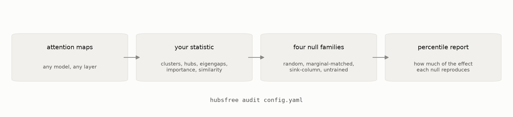</p>

<p align="center"><em>The toolkit in one line.</em></p>

<p align="center">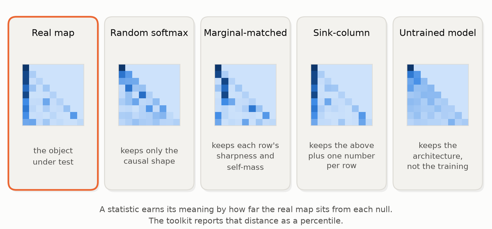</p>

<p align="center"><em>What each null keeps; the real map's distance from each is the report.</em></p>

- **The `hubsfree` toolkit.** Because the standard signatures appear on
  noise, every statistic computed on attention maps (clusters, hubs,
  eigengaps, special heads, similarity or interaction matrices, importance
  scores) now has a null to be measured against. The toolkit runs the
  families in one command: random causal or bidirectional softmax matched
  in heads and length, per-row marginal-matched surrogates, surrogates
  preserving the sink column set, and two dissociation controls that keep
  every head as concentrated as it was while removing the shared column.
  The report gives the real statistic's percentile in each null and the
  fraction of the effect each null already reproduces. `hubsfree extract`
  saves a layer's maps from any Hugging Face model, `hubsfree audit` runs
  the battery on them, `hubsfree demo` shows the random-matrix coordinator
  in under a second; the guide is `docs/toolkit.md`.
- **Sink-aware head comparison.** Because one column carries most of the
  inter-head signal, any pipeline that ranks, clusters, merges, or prunes
  heads from attention maps (attention-based importance, attention
  rollout, similarity-based head merging) can now report its result
  against a sink-preserving null. Without it, the pipeline is largely
  measuring how much each head attends to the sink token.
- **Base rates before calling a component special.** Because the 2-sigma
  rule flags a special head, neuron, or dimension on pure noise 62 percent
  of the time at 14 candidates and 96 percent at 32, the repository
  tabulates the false-flag rate of k-sigma rules as a function of n. The
  same table applies to any outlier hunt among n components, well beyond
  attention.
- **Matched-noise floors for formula discovery.** Because symbolic
  regression reaches nontrivial fit quality on noise, the battery reports
  the best fit the identical search achieves on shape-matched noise, the
  line a real fit has to clear. Built for "AI scientist" pipelines that
  fit laws to model internals.
- **A working protocol for AI-assisted analysis.** Every number in this
  repository was produced under one discipline: the artifact is written
  before the number is cited, nulls run before interpretation, thresholds
  are frozen and pushed before the runs, evaluation code is committed
  before results exist, and registered predictions that fail are reported
  as failures. The protocol is documented end to end in the commit history
  and is ready to adopt.
- **A reviewer's checklist** (paper.md, Section 6) for structure findings
  about attention, usable as is in peer review or internal model reports.

## Where the work goes next

- **A redundancy diagnostic for inference: tested, and it is not one.**
  The shared-energy fraction is one number per layer that says how much of
  the heads' operator content is one shared component. A preregistered
  test asked whether it predicts which layers tolerate head merging, and
  whether the generator cosine picks the pair to merge, on Qwen2.5-1.5B, 3B
  and 7B. Both predictions failed as registered: merging any pair of heads
  within a KV group costs a median 0.0007 to 0.0013 nats per token at
  almost every layer, and neither the cosine nor the shared energy says
  which pair or which layer. The fraction is a measurement of attention
  geometry, not a tolerance tool, and the repository says so.
<p align="center">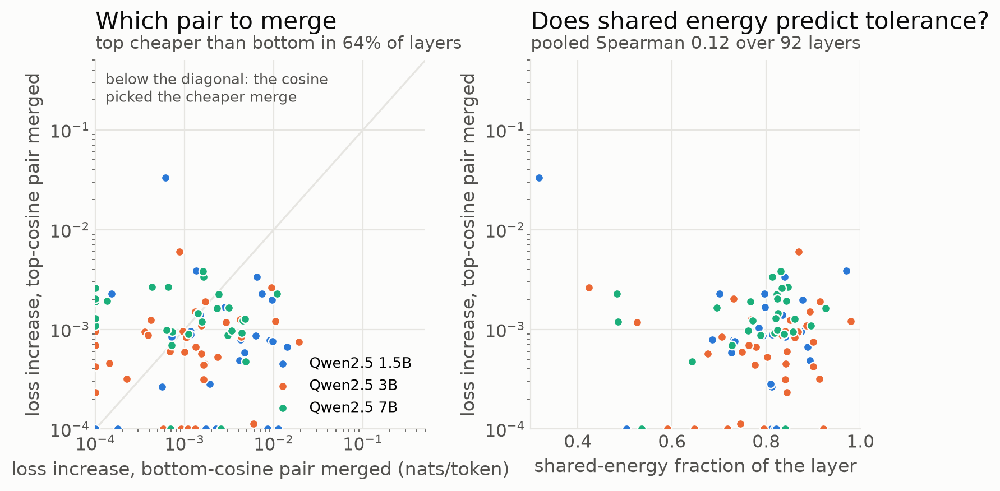</p>

<p align="center"><em>The failed practical test: merges are cheap almost everywhere, and neither the pair cosine nor the shared energy predicts the cost.</em></p>

- **The same test with function in the loop: the map is the weak link,
  not the sink.** Every earlier result compares attention maps with
  surrogate maps. A further preregistered round weighted attention by the
  vectors it actually moves and repeated the merging test on four held-out
  models, measuring how much each merge changes the model's predictions.
  The sink is small per position: the vectors it passes on are about a
  ninth the size of other positions'. It still supplies about half of each
  head's output, because the other positions' contributions partly cancel.
  Weighting by those vectors halves how much of head similarity the sink
  accounts for. Removing the sink columns does not make map similarity
  predict merge damage any better. Bringing in the values and output
  weights does, from about 0.38 to 0.65 within a layer, with that ordering in
  every model. Two registered predictions failed: the commutator object
  was not reliably worse than the plain map, and the better predictor did
  not choose reliably cheaper single merges.

<p align="center">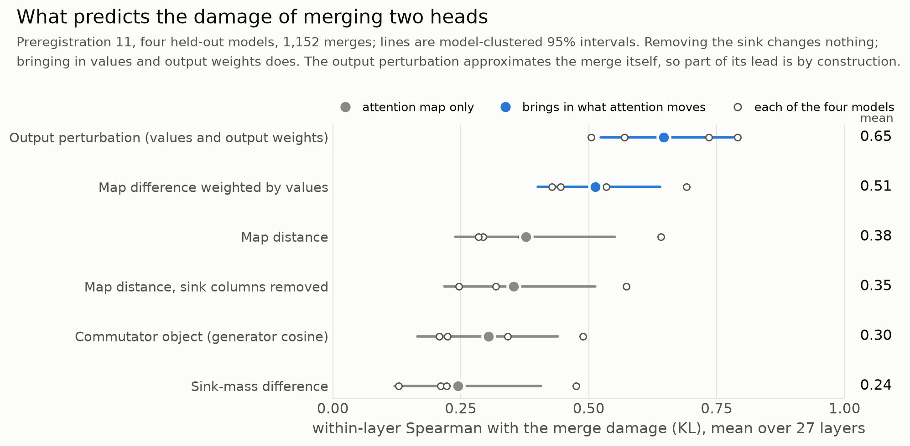</p>
<p align="center"><em>Comparisons that see only the attention map predict merge damage weakly, with or without the sink; comparisons that include what attention moves predict it best.</em></p>

- **The statistics the field uses, tested the same way.** A third
  preregistered round took the comparisons published papers use. For pairs
  of heads, Clark et al.'s divergence and CHAI-style correlations predict
  merge damage at 0.29 to 0.43, against 0.65 for the output perturbation.
  When one pair per key-value group is merged in every layer, as
  compression methods do, pairs chosen by output perturbation cause 0.58
  to 0.86 of the damage of pairs chosen by the commutator or CHAI-style
  criteria, in all four models; at twice that budget the advantage shrinks
  in two of them. For single heads, the round took the average largest
  attention weight over all tokens. That version is a sink detector: it
  tracks how much a head attends to the sink at 0.92, and against the
  damage of actually removing a head it has the wrong sign, because heads
  that attend to the sink more matter less. The size of a head's output
  predicts the damage at 0.53 within a layer, though not across layers.
  All eight registered predictions held. Repeated at four times the context
  on two models, six of seven held; the advantage over the commutator
  criterion stayed in both models but missed its registered size. On GPT-2
  and Pythia, which use multi-head attention, and on a second corpus, C4,
  all seven head-importance predictions held, with output norm at 0.68 and
  0.69; in these models it also ranks heads across layers.

<p align="center">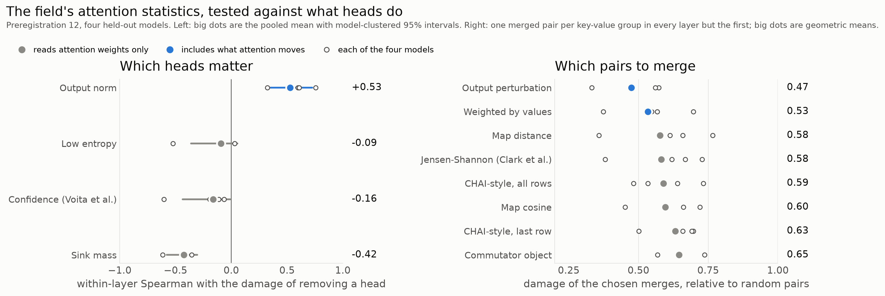</p>
<p align="center"><em>Computed over all tokens, attention confidence points the wrong way, and the similarity statistics in use choose costlier merges than a comparison that includes what attention moves.</em></p>

- **Head confidence, as its authors defined it.** The all-token statistic
  above is not quite Voita et al.'s "confidence", although an earlier
  version of this page called it that. They average a head's largest
  attention weight with the end-of-sentence token left out, because it is
  not a real token. In translation encoders that token draws a large share
  of attention, the role the sink plays in a decoder. Computed their way,
  with the sink left out, confidence predicts the damage of removing a head
  in all seven decoders tested (+0.32 against -0.21 for the all-token
  version). In the setting they studied, the encoder heads of translation
  models for their three language pairs, it predicts the damage at +0.53,
  and there leaving the token out barely matters (+0.48 with it included);
  that token takes only about a fifth of the attention. Five of six
  registered predictions held; the one that failed expected that exclusion
  to matter in translation encoders. In both settings the norm of what a
  head writes predicts better.

<p align="center">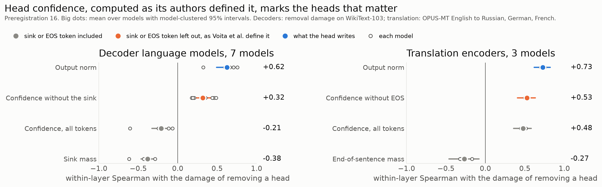</p>
<p align="center"><em>Leaving the sink out turns confidence from a sink detector into a marker of heads that matter in decoders; in translation encoders it works with or without the end-of-sentence token, and output norm predicts better in both.</em></p>

- **A benchmark for merging heads.** Methods that share keys and values
  between heads, or convert multi-head to grouped-query attention, choose
  which heads to merge by a similarity: of attention scores, of query and
  key weights, of key and value activations. A preregistered benchmark
  merged every pair of key-value heads in every layer of GPT-2 medium,
  Pythia-160m and Pythia-410m, 6,552 merges, and measured the damage of
  each. No similarity in use predicts it: within a layer they reach Spearman
  0.12 at best. Simulating the merge on 2,048 tokens predicts it at 0.72,
  and the merges it chooses cost 0.28 to 0.57 of those chosen by the
  CHAI-style correlation, at one pair per layer, and 0.35 to 0.48 at two.
  All five registered predictions held. A second round repeated it at larger
  scale and on a task: in Pythia-1.4B, OPT-1.3B and GPT-2 large (21,624
  merges) the simulation predicts the damage at 0.68 while the similarities
  in use average 0.24 or less, and across 72 merge configurations the drop
  in LAMBADA accuracy follows the KL damage at Spearman 0.86. Its merges
  lose less LAMBADA accuracy than the CHAI-style choice in 5 of 6 models at
  one pair per layer, but only 4 of 6 at two pairs, so that registered
  prediction failed: at two pairs GPT-2 medium lost 11 points of accuracy
  against the CHAI-style choice's 4 despite half the KL, and in OPT-1.3B,
  where the chosen merges move accuracy by at most 2.5 points, the
  CHAI-style choice did slightly better at both budgets.

<p align="center">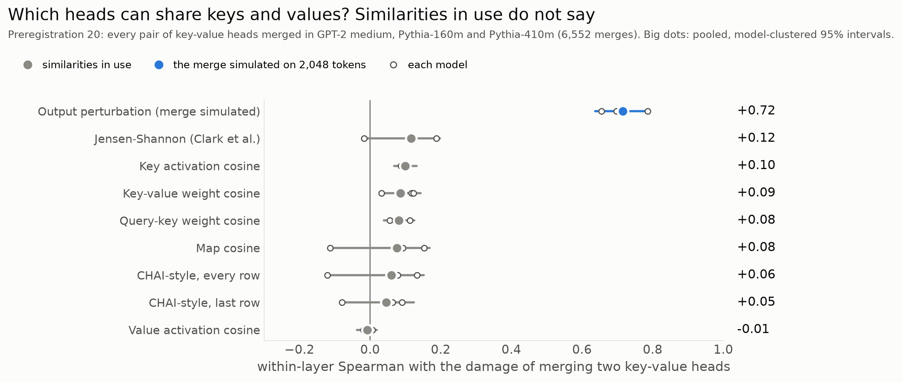</p>
<p align="center"><em>Every similarity used to decide which heads can share keys and values is close to uninformative about the damage; simulating the merge is not.</em></p>

- **Converting heads to shared key-value heads, without training.**
  Grouped-query attention lets several query heads share one key-value head,
  which divides the key-value cache by the group size. An existing
  multi-head model is converted by averaging the key and value projections
  within each group (Ainslie et al. 2023), and published methods differ in
  how they choose the groups. A preregistered round converted five models
  (OPT-1.3B, Pythia-1.4B, GPT-2 large, OLMo-1B, Phi-2) to half and to a
  quarter of their key-value heads with nine recipes and no training:
  neighbouring heads, random groups, the groupings of QCQA, AsymGQA and Jin
  et al., and the simulated merge, each with or without Jin et al.'s
  alignment, which first rotates every head's internal basis in a way the
  unconverted model does not notice. Without alignment, every recipe left
  perplexity at 13 to 1,250 times the unconverted model's at half the heads,
  and the published grouping criteria stayed within a factor of two of
  random groups. Aligned, with the groups chosen by the simulated merge, the
  converted models had the lowest perplexity of the nine recipes in all ten
  settings and beat Jin et al.'s grouping in all ten: at half the heads, 33
  against 49 in OPT-1.3B (unconverted 16.8) and 35 against 57 in Phi-2
  (11.0), with higher average accuracy than Jin et al.'s on seven zero-shot
  tasks in all five models (1.6 to 5.3 points). The averaging recipe also
  depends on an arbitrary choice: rotating each head's internal basis, which
  leaves the model unchanged, moves the perplexity of unaligned averaging by
  a factor of 1.1 to 4, while aligned averaging gives the same model in
  every basis. The best conversion still leaves perplexity at 2 to 5 times
  the unconverted model's in four models and 43 times in OLMo-1B, so without
  training it is a starting point for uptraining rather than a finished
  model. One registered prediction failed: summed over layers, the simulated
  cost does not order the recipes' damage in OLMo-1B, where damage compounds
  across layers beyond what the per-layer simulation sees, or in Phi-2 at a
  quarter of the heads, where the simulation misses what alignment adds.
  Nine of ten registered predictions held.

<p align="center">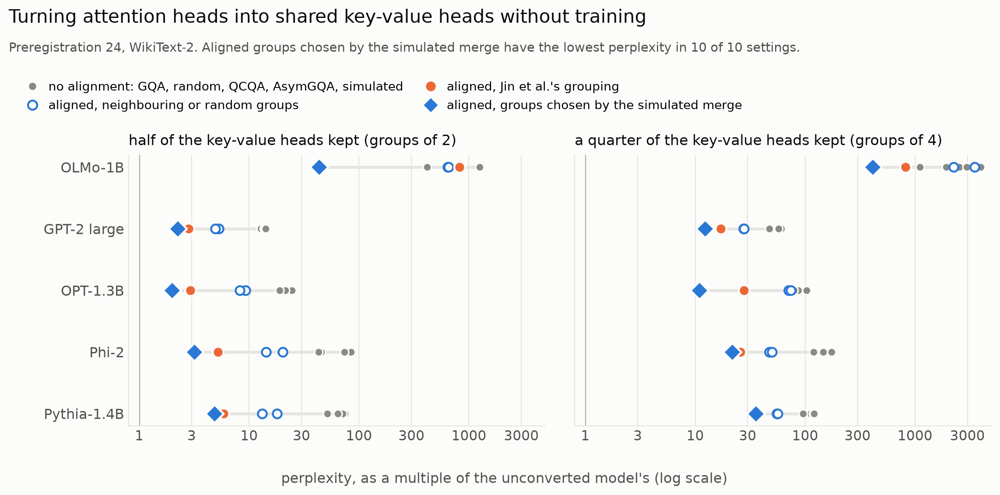</p>
<p align="center"><em>Without alignment no way of choosing the groups helps; aligned, choosing them by the simulated merge gives the lowest perplexity in every model and group size.</em></p>

<p align="center">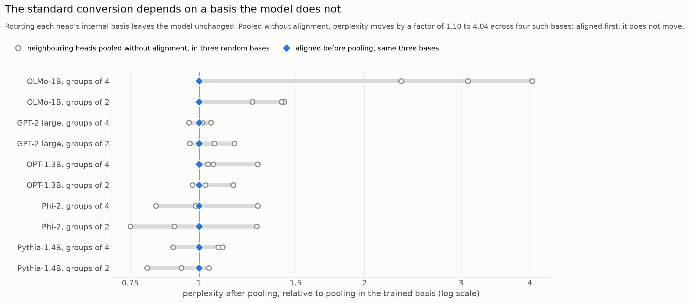</p>
<p align="center"><em>The standard recipe gives a different converted model in each of the equivalent bases; aligning first removes the dependence.</em></p>

- **What the sink does.** A fourth round edited the sink directly. Removing
  its contribution from every head costs 28 to 68 times as much as removing
  an ordinary token's, in all four models, so the sink is not the no-op the
  literature describes. Replacing it with its average, a constant vector
  per head, keeps only 13 to 43 percent of that damage: most of what the
  sink does is act as a bias. All four registered predictions held.

<p align="center">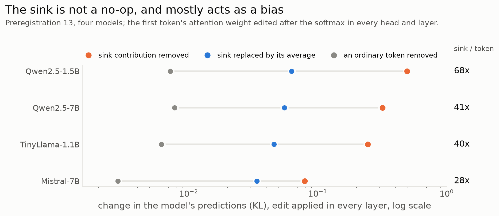</p>
<p align="center"><em>Removing the sink's contribution hurts far more than removing an ordinary token; replacing it with a constant recovers most of the damage.</em></p>

- **The sink across architectures, and streaming without it.** A further
  round asked whether that holds beyond those four models. In Pythia-410m
  and OPT-6.7B removing the sink costs 16 and 14 times an ordinary token, and
  a constant vector reproduces 0.69 and 0.58 of its effect. GPT-2 medium is
  the exception: its sink is cheaper (2.2 times) and gate-like, which a
  constant does not reproduce, so the registered idea that the position
  scheme decides this failed. In encoders the special tokens are close to
  no-ops: removing BERT's [SEP] or a translation encoder's end-of-sentence
  token costs about as much as removing an ordinary token. Under
  sliding-window attention, evicting the first token breaks generation, as
  StreamingLLM found; a constant per-head virtual sink, with no sink token
  kept, recovers 87 and 54 percent of what keeping the first four tokens
  recovers in Qwen2.5-1.5B and Pythia-410m, but 6 percent in TinyLlama,
  whose sink is not concentrated on the first token. Three of six registered
  predictions held.

<p align="center">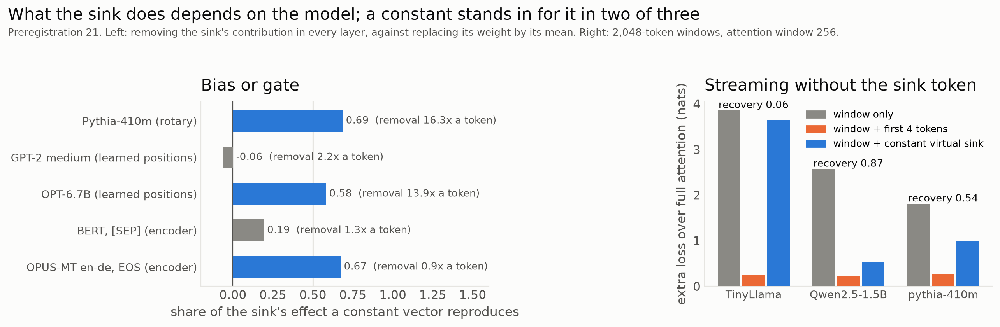</p>
<p align="center"><em>The sink is a costly constant bias in most decoders tested, a gate in GPT-2 and nearly a no-op in encoders; where it is a bias, a constant can replace the sink token.</em></p>

- **Turning the nulls on published findings.** The audit program
  (`audits/TARGETS.md`) asks whether well-known findings about attention
  heads survive the same nulls: the layer clustering of BERT's heads
  (Clark et al. 2019), the attention-pattern taxonomy (Kovaleva et al.
  2019), cross-head redundancy as used for KV compression (CHAI, 2024),
  spectral outliers in projection weights (2026), and retrieval heads as
  the positive control the nulls must not remove. Four base results are
  reproduced or partially reproduced and their criteria frozen in
  `audits/PREREGISTRATION4.md` (the layer clustering; the spectral
  outliers, whose counts match the source to 0.3 percent; the retrieval
  heads, 4.2 percent of heads against the source's 3 to 6; the redundancy
  clusters in part, with the source's depth trend not reproduced); the
  attention-pattern taxonomy could not be reproduced because its classifier
  and annotations were never released. The criteria were frozen by public
  commit before any battery ran (`ee4e267`, 2026-09-14), the evaluation
  script was committed before any result existed, and all six batteries are
  now complete (`audits/RESULTS.md`). Three findings shrink and the control
  holds. A null that keeps only the shared separator columns reproduces two
  thirds of BERT's layer clustering, and the row values alone a tenth. In
  Clark et al.'s own input format, cased BERT on two-segment inputs of 128
  tokens, a seventeenth preregistered round finds the same 64 percent.
  Papamichalis and Ruane (2026) found independently that the most prominent
  structure of a standard BERT head-clustering pipeline depends on whether
  the metric keeps or drops the sink.
  The cross-head redundancy behind a KV-compression method is mostly the
  shared sink column: the sink-kept null reproduces a median 96 percent of
  it on Mistral-7B and 68 percent on OPT-6.7B, from the OPT family the
  source evaluates, when the last token's row is read. The source does not
  say which rows it correlates; read over every row, as the maintainers'
  dump code does, the share stays at 97 percent on Mistral-7B but falls to
  43 percent on OPT-6.7B, below the registered half. A Gaussian
  matrix matched in shape and norm produces 85 to 89 percent of the
  reported spectral outlier count in the square projections, because the
  recipe places its Marchenko-Pastur edge inside the bulk; with the edge
  calibrated, a Gaussian has none and the real counts fall by a factor of
  1.3 to 9. Retrieval heads, the positive control, sit above every draw of
  the three randomization nulls on two models with about one percent of
  their score reproduced. Notes go to the original authors with four weeks to respond.

<p align="center">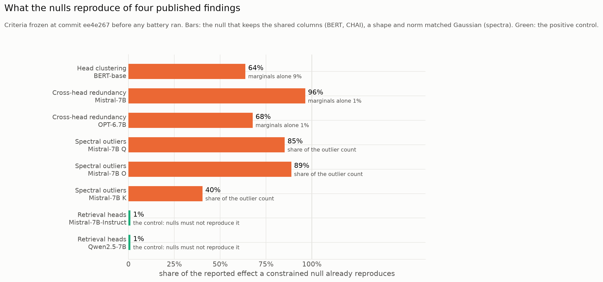</p>
<p align="center"><em>Each bar is the share of a published effect that a null reproduces while keeping the constraint named beneath it. The control at the bottom is what the nulls must not reproduce, and do not.</em></p>

- **A rule for which claims survive, tested on six new ones.** The audits
  fit one pattern: findings that summarize whole attention distributions
  shrink, findings about where heads look survive. A preregistered round
  stated that as a rule and tested it on six claims nobody had audited with
  nulls. All six reproduce, and the rule predicted four. Heavy hitters, the
  observation behind the H2O cache-eviction method, are mostly the sink
  (64 percent); induction, positional and syntactic heads survive (at most
  1 percent). But persistence of importance and the observation-window hit
  rate, behind Scissorhands and SnapKV, survive as well (0.2 and 4 percent),
  against the prediction. The reading that fits all six came out of the
  development run and is labeled as such: statistics that weigh attention by
  its mass are dominated by the sink, statistics that count positions above
  a threshold are not. A later preregistered round tested that reading
  prospectively by computing five audited statistics both ways on the same
  maps. Weighted by attention mass, the null that keeps the shared columns
  reproduces 52 to 95 percent of each; counted, 0.2 to 27 percent, and the
  registered gap of 0.3 held for all four decoder statistics (0.42 to
  0.85). A sharper version, that the sink matters in proportion to the
  share of a statistic's units it occupies, predicted a small gap for
  Clark's top-5 count, where the two separator columns can take two of the
  five counted slots. The gap was 0.37, so that prediction failed: the
  weighting moves the sink's share in all five pairs, the small-k case
  included.

<p align="center">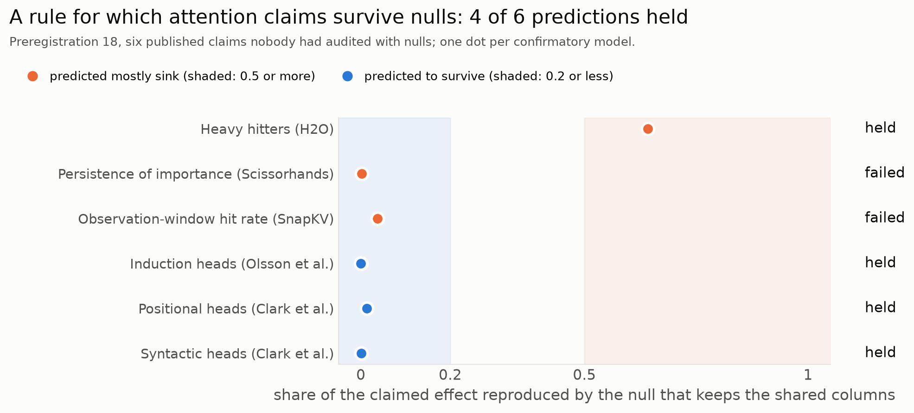</p>
<p align="center"><em>Four of six predictions held; the two that failed are statistics that count positions rather than weigh them by attention.</em></p>

<p align="center">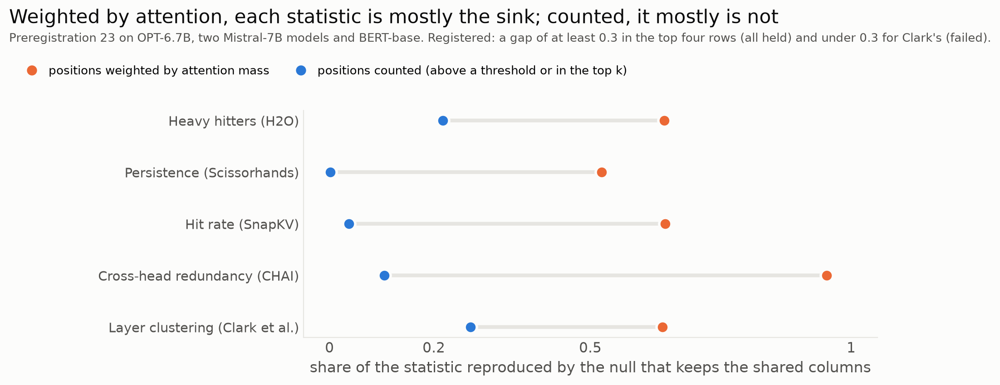</p>
<p align="center"><em>Same maps, same claim, two weightings: counting positions instead of weighing them removes most of the sink's share in all five. The registered exception for Clark's top-5 count did not hold.</em></p>

- **A vision claim that survives.** The ViT paper reports that attention
  distance grows with depth and that late-layer heads attend widely. Large
  vision transformers develop artifact tokens that absorb attention, which
  could make a row look wide by construction. A preregistered round found
  the claim genuine: in the source's supervised ViT-L/16, and in ViT-B/16,
  the distance rises 24 and 37 pixels into the second half of the network,
  close to the distance of uniform attention, with no artifact columns of
  note. DINOv2-L has artifacts holding 16 percent of late attention, and
  registers remove them, but its attention distance does not grow with
  depth, so the predictions that artifacts carry the trend failed (3 of 5
  clauses held).
- **Deriving the operator rather than measuring it: a floor, not a
  formula.** A preregistered derivation writes each head's energy along
  the ideal sink direction from its own sink mass and row sharpness, with
  no cross-head information, and predicts the layer's shared energy from
  the mean. Across 310 layers of twelve models it orders the layers at
  Spearman 0.86 and sits below the measured value at every high-sink
  layer, within 0.06 at the median, but it explains 55 percent of the
  variance across models rather than the registered 80. The shared energy
  is measured structure with a derived lower bound.

<p align="center">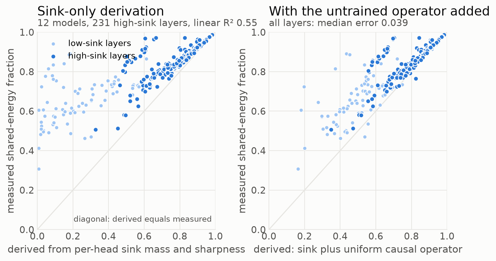</p>

<p align="center"><em>The derived floor tracks the measured shared energy but does not reach it; adding the untrained network's operator closes part of the gap at low-sink layers.</em></p>

## Evidence standard

Twenty-four preregistrations with numeric thresholds and falsification
clauses were frozen in git before their runs (`alignment_study/PREREGISTRATION.md`,
`PREREGISTRATION2.md` to `PREREGISTRATION16.md`, `PREREGISTRATION20.md`
to `PREREGISTRATION22.md` and `PREREGISTRATION24.md`; `audits/PREREGISTRATION4.md`,
`PREREGISTRATION17.md` to `PREREGISTRATION19.md` and
`PREREGISTRATION23.md`; the second committed
before the held-out models were downloaded, the third and all later ones
pushed publicly before execution, evaluation scripts committed before
results existed). Registered predictions that failed are
reported as failures, not reinterpreted: the universal-breakdown
prediction (A1), the first dissociation control (A7, design flaw
documented and replaced), the sharp regime-edge threshold (H4b),
one-column sufficiency on TinyLlama (H2) and OLMo-2 (S2), the
dissociation control at 32 heads (S3), early sink formation on
Pythia-160m (D4), both merge-tolerance predictions (M1, M2), the
derivation gate (G1), in the functional round the advantage of the
plain map over the commutator object (F3b) and the practical merge
criterion (F4), the registered size of the multi-pair merge advantage at
1,024 tokens (S5), the effect of leaving out the end-of-sentence token
in translation encoders (V5), the sink account of CHAI's redundancy on
OPT-6.7B when every row is read (C2), the rule's predictions for two
count-based claims (A2, A3), artifact tokens as the source of ViT attention
distance (V1, V4), the position scheme as what separates bias-like from
gate-like sinks (G2), the size of GPT-2 medium's sink cost (G3), the
constant virtual sink in TinyLlama (G6), the task-level advantage of the
simulated merge at two pairs per layer (D2), the occupancy reading of
Clark's top-5 count (F2), and the per-layer simulated cost as an ordering of
whole-model conversion damage (P6). Out of sample, 7 of 8 registered clauses
passed in the sub-2B round, 3 of 4 in the 3B-to-7B round, 5 of 5 primary clauses in the
training-dynamics round, 4 of 4 in 11 of 11 models in the
fixed-instrument rerun, where the earlier failures on TinyLlama, OLMo-2
and the 32-head models resolved without moving a threshold, 0 of 2
primary clauses in the head-merging round, whose negative result is
reported in full above, 4 of 4 in the sink-profile round, 5 of 5 on
the four new attention designs, 5 of 7 in the functional round, 8 of 8 in
the standard-statistics round, 4 of 4 in the sink-editing round, 6 of
7 at 1,024 tokens, 7 of 7 on multi-head models with a second corpus,
5 of 6 for head confidence as its authors defined it, 8 of 9 for two
audits repeated under the sources' own readings, 4 of 6 for the rule tested
on six new claims, 3 of 5 for vision transformers' attention distance, 5 of
5 for the merge benchmark, 3 of 6 for the sink across architectures, 6 of 7
for the merge benchmark at larger scale and on LAMBADA, 4 of 5 for the
weighting flip, and 9 of 10 for converting heads to shared key-value heads
without training.
Development
calibration that shaped a preregistration is committed and labeled as
such. A blind reimplementation from the written specification
reproduced the anchor values to four decimals; surrogate invariants hold
to 1e-15; confidence intervals resample models, then layers within a model
(`alignment_study/clustered_stats.py`);
adversarial review objections (statistic ill-conditioning, GQA confound,
circularity risks) were tested and are answered in
`alignment_study/NOTE.md`. The synthetic battery regenerates from
`experiments.py` and CI checks it on every push. Every number in every
document regenerates from a committed script into a committed artifact,
with one exception stated in `CLAUDE.md`: the small-model pilot in
paper.md Section 7, whose scripts are author-held pending upload.

## Where this sits in the literature

Attention sinks and their prevalence across heads are documented at the
distribution level (Xiao et al. 2023; Sun et al. 2024; Gu et al. 2025;
Barbero et al. 2025), as is similarity between heads' attention
distributions (Clark et al. 2019; Bian et al. 2021), and constrained
surrogate testing has a long lineage outside interpretability (Theiler
1992; Elsayed and Cunningham 2017; Adebayo et al. 2018). New here, checked
against the literature with adversarial search before being stated: the
operator-level decomposition of a layer's heads and the identification of
its shared component with the sink; the commutator cancellation and its
measured dominance structure; per-row marginal-matched and
column-preserving surrogates for attention statistics; the out-of-sample
alignment-fraction law; and the toolkit that packages the nulls.

Closest recent work, found after the audits were frozen: Papamichalis and
Ruane (2026) show that whether an attention metric keeps or drops the sink
flips 17 to 47 percent of head-similarity verdicts in ten models and decides
the most prominent structure of a standard BERT head-clustering pipeline;
Sandoval-Segura et al. (ICLR 2026) find that output-norm scores identify
inactive heads that attention-weight scores miss; Sok et al. (EMNLP 2026)
prune heads that attend to the first token with little loss; Méloux et al.
(2025) and Heap et al. (2025) show interpretability methods and metrics
returning plausible results on random networks; Fesser et al. (2026)
separate sinks that suppress a head's update from sinks that broadcast
information.

## Repository map

- `paper.md` - the methods paper: what commutator-based analyses of
  attention measure, with the full null battery and a case study.
- `manuscript.md` - the flagship draft that assembles every round, with a
  preregistration ledger and a numbers ledger mapping each reported number
  to its artifact; sections waiting on running rounds are marked.
- `replicate.ipynb` - one-click replication on Colab or Kaggle: toolkit
  demo, tests, synthetic battery regeneration, the anchor check, one
  dynamics cell.
- `experiments.py`, `results.json`, `figures/` - the synthetic battery
  behind paper.md Sections 3 to 4.6; `check_results.py` and
  `.github/workflows/regenerate.yml` verify it regenerates.
- `make_readme_figures.py` - renders every chart and illustration on this
  page from the committed result files.
- `alignment_study/` - the shared-operator studies: five
  preregistrations, all scripts and result JSONs (per-checkpoint dynamics
  results in `dynamics/`, per-model rerun results in `rerun/`), the run
  log, and the study note with scorecards (`NOTE.md`).
- `hubsfree/`, `tests/`, `pyproject.toml`, `docs/toolkit.md`, `examples/` -
  the toolkit (v0.1.0.dev0): statistics, null families including the
  dissociation controls, battery report, CLI, guide and two runnable
  examples.
- `audits/` - audit targets, the frozen preregistration 4 and its addenda, per-target
  reproductions (`clark2019/`).
- `run_qwen_protocol.py`, `qwen_results.json` - the six-prediction
  protocol on Qwen2.5-0.5B.

## Reproduce

```
./setup.sh                                  # pinned environment (requirements.txt)
source .venv/bin/activate
python experiments.py                       # synthetic battery, under a minute on CPU
pip install -e . && hubsfree demo           # the random-matrix coordinator, one second
python -m pytest tests                      # surrogate invariants and anchors
python make_readme_figures.py               # the figures on this page, from the JSONs
python alignment_study/tier1_robust.py      # development-model study
python alignment_study/heldout_round.py     # five held-out models
python alignment_study/dynamics_round.py    # Pythia checkpoints, about 22 GB of downloads
python alignment_study/eval_dynamics.py     # dynamics scorecard D0 to D5
python alignment_study/rerun_round.py       # thirteen models, fixed instruments, about 3 hours plus downloads
python alignment_study/eval_rerun.py        # rerun scorecard S1' to S4
```

Models and datasets download from Hugging Face on first use. The 3B-to-7B
round ran on a Colab T4 from `scale_colab.ipynb`; its captured outputs and
run history are in `alignment_study/scale_partial/` and
`alignment_study/RUNLOG.md`. The dynamics round ran on an Apple M1 Max
through MPS; the device and precision policy and its measured fidelity
against the CPU protocol are in `hubsfree/adapters.py` and the run log.

## Scope and open items

Results cover seventeen models up to 8B parameters in ten families, English
text and code, contexts up to 256 tokens for the structural results and
1,024 for the functional ones, training dynamics for two models of one
family, and, for head importance, the encoders of three translation
models. Later rounds add vision transformers, three more decoders and
one downstream task (LAMBADA accuracy) for the merge benchmark, OLMo-1B,
Phi-2 and seven zero-shot tasks for the conversion to shared key-value
heads, and 2,048-token contexts for the KV-cache and streaming tests. Where the sink
sits on a mid-sequence,
window-varying column (OLMo-2, late Qwen2.5-3B layers) the sink-operator
identification weakens and one-column surrogates lose their grip, which
a set of up to three columns repairs in most layers but not all. In
64-token windows no permutation control can misalign 32 heads, so the
dissociation test needs 256-token windows. The
residual deviation directions carry structure the three-number summary
does not capture, and one low-dispersion layer is ill-conditioned for the
correlation statistic (diagnosed and flagged). Models above 8B
parameters, input in other languages, and contexts beyond 2,048 tokens are
untested.
